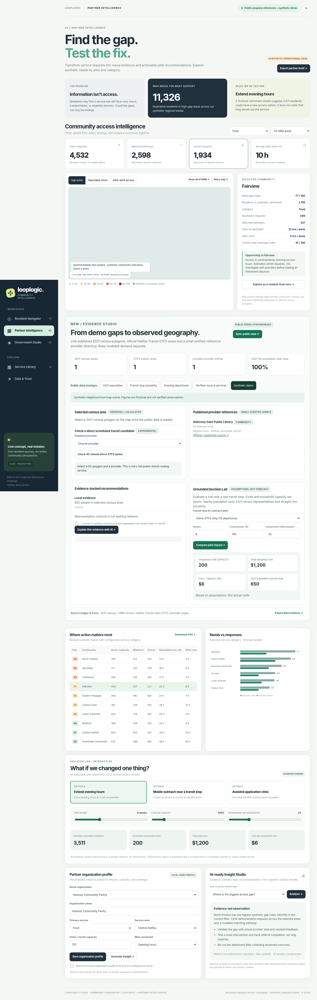

# LoopLogic — Community Intelligence MVP

**From finding help to taking action—and from community needs to better services.**

LoopLogic is a Halifax-focused hackathon prototype connecting three experiences:

1. **Resident Navigator / CivicPath** — discover relevant support, answer structured screening questions, and build a personal action checklist.
2. **Partner Intelligence** — explore service-access concepts, source-attributed geographic evidence, and pilot intervention scenarios.
3. **Government Studio** — compare regional indicators, examine evidence, and experiment with hypothetical resource-allocation decisions.

> **MVP / research prototype (v7, November 2026).** Not an official government service, eligibility determination, live referral system, or production planning tool. Original demand, match, gap and allocation metrics are **synthetic**. Public census and transit layers require an explicit local sync and verification.



## Why we built it

People often need help across more than one category—housing, food, affordable transportation, heating and senior supports—but must navigate separate websites, forms, eligibility rules and provider hours. Community organizations need evidence about access barriers; governments need more transparent ways to explore interventions. LoopLogic demonstrates how a single resident journey could connect with responsible, privacy-aware planning intelligence **without assuming that a search equals unmet demand or a completed referral**.

## Current capabilities and maturity

| Area | Included in v7 | Data / limitations |
|---|---|---|
| Resident profiles | Three fictional scenarios and editable custom demo profiles | Browser-local demo data; no authenticated accounts |
| Service matching | 12 curated program/directory entries across food, housing, transit, heating, seniors and community support | Check live availability and rules at linked official sources |
| CivicPath assistant | Guided service suggestions; optional server-side OpenAI explanations with explicit opt-in | Not a general autonomous agent; no form submission or booking |
| Rent screening | Six-question, deterministic Canada–Nova Scotia Rent Supplement **intake** | Does **not** determine benefit eligibility |
| Action tracker | Six-step checklist, affordability indicator, browser-local saved progress and export | Actual rent / gross income is not the provincial market-rent eligibility test |
| Partner map | Interactive OpenStreetMap plus synthetic gap/reachability overlays | Online basemap is geographic; gap scores and operating KPIs are illustrative |
| Public geography | On-demand HRM 2021 census DA boundaries/population and Halifax Transit static GTFS data | Requires successful sync; historical population and published schedules, not real-time travel |
| Provider references | Small hand-curated directory and geocoding experiments | Not comprehensive; addresses and hours require provider confirmation |
| Transit analysis | Stop proximity, evening departures, exploratory *direct* GTFS journey candidates | No transfers, pedestrian-network routing, realtime delays or guaranteed service reachability |
| Decision Lab | Interactive pilot weeks, session cost, capacity and estimated cost-per-visit | Scenario assumptions, **not** verified forecasts or impact |
| Government Studio | Evidence view and synthetic funding-allocation exploration | No government approval or real budget optimization |

## Run locally (Windows, macOS, Linux)

**Requirements:** Python **3.10+**. The basic server and geographic modules use Python's standard library; no pip installation is required to run the core app. Internet access is required for OpenStreetMap tiles and public-data sync.

```powershell
# In the repository folder (where ai_server.py is located)
python --version
python ai_server.py
```

Open **http://127.0.0.1:8000**. Stop with `Ctrl+C`.

If port 8000 is occupied, in PowerShell:

```powershell
$env:LOOPLOGIC_PORT = '8001'
python ai_server.py
```

The server deliberately listens on `127.0.0.1` only. Do **not** expose it directly on a public network.

### Optional generative AI

The guided assistant, screening, tracker and map work without an API key. To try AI narrative generation, use an OpenAI API project with available prepaid credit. **API usage is billed separately from ChatGPT.** Never paste a key into a chat, website JavaScript or Git commit.

In Windows PowerShell, to enter the key without printing it in your command history:

```powershell
$credential = Get-Credential -UserName 'OpenAI' -Message 'Paste your API key in the Password field'
$ptr = [Runtime.InteropServices.Marshal]::SecureStringToBSTR($credential.Password)
try { $env:OPENAI_API_KEY = [Runtime.InteropServices.Marshal]::PtrToStringBSTR($ptr) }
finally { [Runtime.InteropServices.Marshal]::ZeroFreeBSTR($ptr) }
python ai_server.py
```

Open `http://127.0.0.1:8000/api/status`; `ready: true` only means a key is detected, **not** that billing or live requests have been validated. In Resident Navigator, enable the explicit AI consent checkbox before submitting a **fictional** profile. Do not use real sensitive resident records.

## Suggested two-minute MVP walkthrough

1. **Resident (0:00–0:40):** Select Jordan, show multiple needs, curated service matches, and a preliminary structured rent-support intake.
2. **Action (0:40–1:00):** Show the 57.5% fictional rent-to-income indicator, six-step Action Tracker and persistence across refresh; emphasize this is *not an eligibility decision*.
3. **Partner (1:00–1:30):** Switch Gap Score / Reachable Hours / After-work Access, select a community, and explain the synthetic demonstration. Show the distinct public-data section and source ledger if sync has succeeded.
4. **Government (1:30–2:00):** Change pilot assumptions, compare cost and visit capacity, and close with the vision of better coordinated services and measurable partner outcomes.

**Demo rule:** If the live public-data download has not succeeded, show the synthetic map and data-source statuses—not simulated metrics presented as observed Halifax outcomes. For a detailed script see [docs/JUDGE_DEMO_V7.md](docs/JUDGE_DEMO_V7.md).

## How to use each section

| Navigation | What teammates should try |
|---|---|
| **Resident Navigator** | Select Jordan or Custom profile → select needs → see personalized matches → request the Rent Supplement screening → complete six fictional answers → change a checklist status → refresh |
| **CivicPath Action Agent** | Start in guided mode; optionally enable AI consent when a server-side key is configured. Ask for multi-need guidance. Agent text is advisory; verified steps are separate from AI narrative. |
| **Partner Intelligence** | Choose a category/area → switch the three **synthetic** map layers → click Bedford or Fairview → examine KPIs and selected-community summary. |
| **From demo gaps to observed geography** | Click **Sync public data** (requires internet) → inspect each feed status → select 2021 population, stop proximity, evening departures or service reference layers → inspect sources. |
| **Grounded Decision Lab** | Select a GTFS stop (after sync) → change pilot weeks, cost per session and household visits → interpret capacity and costs as hypothetical. |
| **Government Studio** | Explore evidence and clearly labeled synthetic policy allocation; never equate proximity with observed need. |
| **Service Library** | Review entries and official external links, and verify current eligibility and provider hours before use. |
| **Data & Trust** | Review source attribution, model assumptions, local storage and privacy caveats. |

## Data sources and what they really show

- [HRM 2021 Census Dissemination Areas / ArcGIS feature layer](https://services2.arcgis.com/11XBiaBYA9Ep0yNJ/ArcGIS/rest/services/Census_2021_Dissemination_Areas/FeatureServer/0) — geographic areas and **2021** population.
- [Halifax Transit GTFS static feed](https://gtfs.halifax.ca/static/google_transit.zip) — published stops, routes and schedules, **not** real-time actual service.
- [Feed Nova Scotia](https://feednovascotia.ca/find-food/) and [Halifax Public Libraries](https://halifax.bibliocommons.com/v2/locations) — curated provider references, subject to change.
- [OpenStreetMap attribution](https://www.openstreetmap.org/copyright) — basemap, with internet access.

The app's data fetch is manual. Results are cached locally in `cache/` (gitignored). First sync can partially fail; inspect the app's feed-status and evidence notes. A proximity radius is not walking distance; a scheduled departure is not proof of a usable 45-minute door-to-door trip. Study bounds are the core Halifax/Dartmouth/Bedford/Sackville vicinity, **not all HRM**.

Source labels, licensing notes and data limitations are documented in [docs/V7_README_START_HERE.md](docs/V7_README_START_HERE.md).

## Tests

Run these from the repo root:

```powershell
python -m unittest test_geo_intelligence test_screening test_post_screening -v
```

If you have Node.js installed:

```powershell
npm test
```

Mocked and unit tests do **not** establish successful live feed synchronization or accurate real-world service access. Verify real data on the demo machine before presenting empirical conclusions.

## Repo layout

```text
.
├── index.html, styles.css, app.js, data.js   # Core website and sample catalogue
├── geo_ui.js, leaflet-core-local.css         # Geographic UI
├── ai_server.py                              # Local API + optional AI
├── screening.py, post_screening.py           # Structured intake and action plan
├── geo_intelligence.py                      # On-demand public-data adapter
├── test_*.py, tests.mjs, tests/             # Tests
├── cache/.gitkeep                            # Cache folder only; no downloaded data
├── docs/                                     # MVP runbooks, changelog and source notes
├── .env.example, .gitignore                  # Configuration template and exclusions
└── PROJECT_PREVIEW.png                       # Screenshot generated from project interface
```

## Team collaboration

See [CONTRIBUTING.md](CONTRIBUTING.md). Recommended ownership: **frontend/UX**, **CivicPath and eligibility rules**, **geographic data and analytics**, and **QA/documentation**. These are workstreams, not attribution claims.

Use feature branches and pull requests; do not merge into `main` without a second person reviewing changes to official eligibility statements, AI behavior, privacy or data provenance.

## Next steps after MVP

- Verify every live feed and curated provider location/hours; improve pagination and HRM coverage.
- Move from straight-line proximity/direct-route heuristics to accessible pedestrian-network + full GTFS routing with transfers.
- Implement authenticated resident and organization accounts, privacy protection and consented outcome tracking.
- Build authoritative, versioned program eligibility rules, safer agent tool calling and audit trails.
- Validate partner scenarios with real provider capacity data before using them for operational decisions.

## Privacy, safety and attribution

**Do not commit API keys, uploaded resident applications, ID documents, downloaded personal records or local caches.** The app is demonstration software, not a public benefits application service. All resident demos should use fictional information; no applications or appointments are submitted. See [SECURITY.md](SECURITY.md).

The original Community Navigator concept and CivicPath integration were developed through a team hackathon workflow. Please agree on individual contributions and license terms with all team members before adding external credits or a public license.
